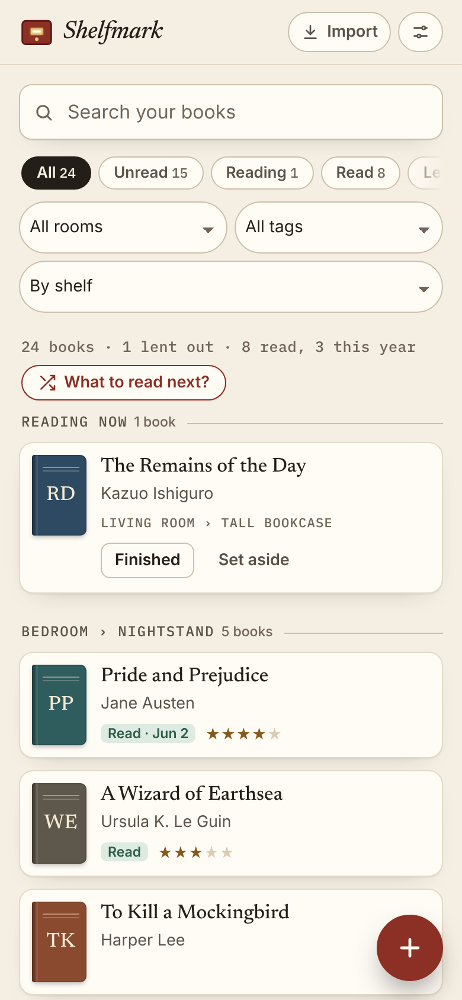
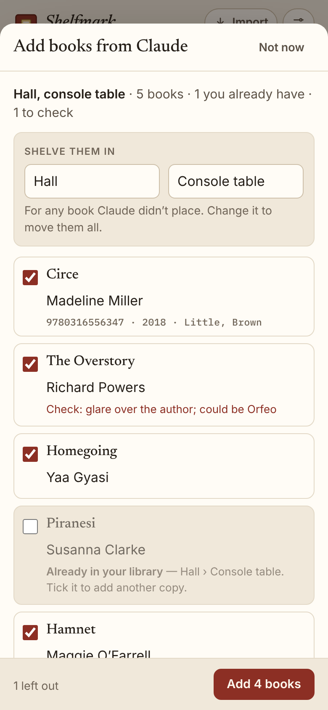
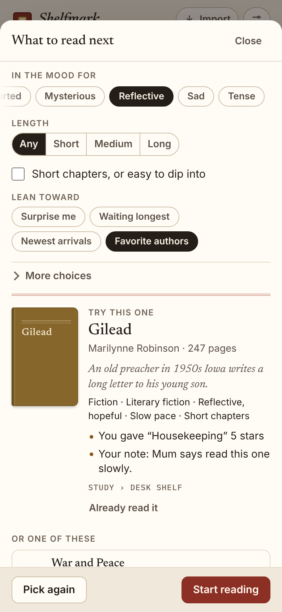

# Shelfmark

**Use it: [shelfmark.junkdrawer.works](https://shelfmark.junkdrawer.works/)**

**A catalog for the books in your house: what you have, where each one is, what you've read, and who borrowed what.** Photograph a shelf, send the photos to Claude, and open the link it gives you: Shelfmark shows the books to check, with the ones you already own unticked, before anything is added. Your catalog stays in your browser, and in your own Google Drive if you turn on sync.

<p align="center">
  
  &nbsp;
  
  &nbsp;
  
</p>

## How it works

- **Catalog.** For each book it keeps:
  - title, subtitle, authors
  - ISBN, publisher, year, pages, format
  - where it is: a room and a shelf, in your own words; one typed with other capitals ("Living Room") goes into the one you have ("Living room")
  - unread, reading, read or set aside (one you gave up, kept out of What to read next), the day you finished it, and a rating (stars given to an unread book mark it read; Read fills in today as the day finished, to change or empty)
  - who you lent it to, and since when
  - tags and notes
  - edition details: signed, first edition, condition, printing
- **Find things.** Search matches every field you’d type for: borrowers, a book's Check note, its edition ("signed", "first edition", "hardcover") and its reading details ("slow pace", "short chapters") included. Each word you type finds the words it starts, so "tolk" finds Tolkien but "fiction" doesn't find nonfiction, and an apostrophe can be typed straight, curly or not at all; a number is found anywhere (part of an ISBN, a year), and so is a piece of a Chinese, Japanese or Korean title. Filters cover status, lent out, to check, the wishlist, room and tag. Sort by author, title, shelf (grouped under each room and shelf), newest first, or recently finished (the Read list is in that order). The count says how many you've read this year.
- **Reading now.** With no search or filter on, the list starts with the books you're reading (they're in their place below too). **Finished** marks one read today, with Undo and **Rate it**, which opens its card at the stars; **Set aside** gives one up.
- **Mark what you've read.** **Settings › Mark what you've read** lists your unread books shelf by shelf, each with a tick, and a Shelf menu narrows it to one bookcase, to stand in front of it and tick what you've read. **Mark 12 as read** marks them all at once, with Undo. What to read next offers it too, while no book is marked read.
- **A wishlist.** A book you want rather than have is kept apart: it's out of the counts, rooms, shelves and What to read next, with its own **Wishlist** chip, and a search shows it with a **Wanted** badge, so one search in a shop answers both "do I own it?" and "did I mean to buy it?". Add one by hand (from the Wishlist chip, or tick **On my wishlist**), or from Claude (a photo of a shop's table, or a list). **Got it** on its card brings it home, added today; adding the same book to the house, by hand or from a shelf's photo, takes it off the list.
- **Add from photos.** Claude reads spines, covers, barcodes and copyright pages and makes a Shelfmark link. Opening it shows the list first. There you can:
  - see what the batch says of each book (read or reading, stars, a loan, a signed copy or first edition, the format, its reading details and a line about it), and fix titles and authors, a long title shown whole, each checked against your library again as you type;
  - put the whole batch on one shelf (a book going somewhere else says where, as you type), and mark it all read (**I’ve read all of these**: a book the batch says you're reading stays Reading);
  - see books you already own, which are unticked (another edition, when the ISBNs differ), and another volume of a set you have, which stays ticked with a note;
  - see anything Claude wasn't sure of, marked **Check**.
  Checked books keep a **To check** filter until you say they're right. **Undo** on the toast after adding takes the whole batch back out, and closing the list without adding says to tap the link in Claude again when you're ready.
- **Reading details.** Claude can add what each book is like: fiction, nonfiction or poetry; genres; moods (funny, tense, reflective…); pace; chapter length; whether it's read cover to cover, dipped into, or browsed (cookbooks, picture books, reference); a line about it; and a page count where there's none. Ask Claude with the Shelfmark skill, and it reads your library (from Drive, or a backup you send) and hands back a link. Opening it shows the list, then fills in only what each book doesn't have yet. Each book's card has a **Reading details** section to change them by hand.
- **What to read next.** Tap **What to read next?** for a suggestion from the unread books you have on hand (books lent out, set aside or on the wishlist, and books you browse rather than read, are left out), with two more to choose from. Each book counts once, however many copies you have, and a copy of one you've read or are reading doesn't come up; the volumes of a set come in order, the next one once you've read the one before ("Next in the set: you've read Book 1").
  - With reading details, choose fiction, nonfiction or poetry, the moods you're in for (any of those picked), and short chapters or something to dip into. **More choices** has genre, pace, tag, room, and books you browse.
  - Narrow it by length (short is under 250 pages, long over 450), once some of your books have a page count.
  - Lean it toward books **waiting longest** or the **newest arrivals**, once books were added on different days, or toward **favorite authors** (ones whose books you've read and rated highly), once one of theirs is waiting unread. **Surprise me** is a plain random pick. Only the choices that would bring a pick are offered: with Poetry chosen, only the moods, paces, lengths, rooms and tags your poems have.
  - Tick **Include rereads** to bring back books you gave four or five stars; the notes say when one of them would match.
  - When nothing matches, a button puts the choice in the way back to Any ("Any length · 14 books"), or **Clear these choices** starts over.
  - Each suggestion has its line and details, says why in plain words ("You finished “Housekeeping” in March and gave it 5 stars", "Your note: …"), and which shelf it's on. **Pick again** works through every match before repeating one, and never shows the same pick twice running. **Already read it** marks it Read and picks again, and **Start reading** marks it Reading and says where it is.
  - Your choices are remembered on each device.
- **Covers and lookups** from Open Library, only if you turn them on in Settings. Covers are found by ISBN, or by title and author for a book without one (so a cover may show another edition), and each cover's id is remembered in the browser. Lookups send the ISBN, title and author, nothing else.
- **Backups.** Download the whole library as a file, and open it on any device (it merges, after saying how many books it would add, change or remove). There's a spreadsheet (CSV) too, to read or print, with the day each book was finished; it doesn't open back in Shelfmark.
- No account and no server. Your catalog stays in your browser, and in your Google Drive if you turn on sync. It installs as an app (from the browser's menu, or Share → Add to Home Screen on an iPhone) and works offline; covers and looking up a book's details need a signal.

## Your data

The [privacy page](https://shelfmark.junkdrawer.works/privacy.html) (`privacy.html`) says this for anyone using it. Your catalog is kept in this browser's local storage and, if you turn on sync, in one file in your own Google Drive. Nothing else stores it: this site is static files, and links from Claude carry their books in the part of the address after `#`, which browsers never send to a server.

Shelfmark asks Google for the narrowest Drive permission there is (`drive.file`). It can see and change only files it made itself, which is one folder, `Shelfmark`, holding `Shelfmark library.json`. It can't see anything else in your Drive. After you sign in it asks Drive for your account's email address, which stays in your browser with the sign-in, so that Settings can show which account it saves to and signing back in skips Google's account chooser. Google's sign-in script loads from accounts.google.com when Settings opens (and whenever the page opens with sync on), so that Connect works on the first tap.

## Sync across devices with Google Drive

Each device keeps its own copy and works offline. When you sync, Shelfmark:
1. reads the file in your Drive;
2. merges it with this device's copy, book by book, keeping whichever version was changed most recently;
3. writes it back if anything changed.

On a new device, an empty Shelfmark offers to connect: open **Settings › Connect Google Drive**, and the list says it's bringing your library while the first sync runs, then how many books came in. Removed books are remembered, so a removal on your phone reaches your laptop instead of the old copy coming back. Two devices connecting at the same moment can each make a library file; the next sync folds the later file into the first one made and puts it in Drive's trash, so every device ends up with the same file and every book. Syncing happens:
- a few seconds after each change;
- when you come back to the tab;
- once a minute while the page is open;
- whenever you tap **Sync now**.

Google signs a page like this out after an hour. When that happens the sync button turns amber and says **Sync**, and one tap signs you back in. Your changes wait safely on the device until then.

The sign-in is kept for the hour under `junkdrawer.google` in localStorage, the same way as the other junkdrawer.works projects, with your account's email address (read from Drive's `about` endpoint after you sign in), so signing back in skips Google's account chooser. Shelfmark has its own address, so it signs in on its own. **Disconnect this device** only stops syncing here (changes not yet in Drive go there first, or, with Google's hour up, wait on the device until you connect again); it doesn't revoke Google's permission, which would sign every project out. **Erase this device's copy** removes the sign-in and the email address along with the library, so connecting again on that device asks Google first. To take the permission back, remove junkdrawer.works under Third-party apps & services in your Google Account.

Drive keeps earlier versions of the library file for 30 days, and only the last 100 (**File information › Manage versions** in Drive). That's from Google's help page [Check activity & file versions](https://support.google.com/drive/answer/2409045): "A version might be permanently deleted after 30 days or if there are 100 newer versions." Shelfmark writes the file a few seconds after each change, so a busy day can use up the 100; download a backup to keep a copy for good. If the file is ever damaged, Shelfmark leaves it alone rather than overwrite it, and says so.

### One-time setup

Sync needs an OAuth client ID from a Google Cloud project, tied to the address Shelfmark is served from. The copy at shelfmark.junkdrawer.works uses the shared junkdrawer.works client, whose consent screen links to [junkdrawer.works/privacy.html](https://junkdrawer.works/privacy.html); steps 3 and 5 are for anyone making their own. It takes about ten minutes:

1. In the [Google Cloud console](https://console.cloud.google.com/), create a project, for example "Shelfmark".
2. In **APIs & Services › Library**, find **Google Drive API** and enable it.
3. Open **Google Auth Platform** (called **OAuth consent screen** in older versions of the console) and choose **Get started**:
   - app name: Shelfmark
   - support email: your address
   - audience: **External**
   - contact email: your address
4. In **Data Access**, choose **Add or remove scopes**. Add `https://www.googleapis.com/auth/drive.file` ("See, edit, create, and delete only the specific Google Drive files you use with this app"), then save.
5. In **Branding**, fill in:
   - **Application home page:** `https://shelfmark.junkdrawer.works/`
   - **Application privacy policy link:** `https://shelfmark.junkdrawer.works/privacy.html`
   - **Authorized domains:** `junkdrawer.works`

   Save. Google won't publish the app without these, even though the form doesn't mark them required.
6. In **Audience**, choose **Publish app**. `drive.file` is a non-sensitive scope, so publishing needs no review. Or skip publishing: an app left in **Testing** works for the Google accounts you add under **Test users**, but Google may ask them to approve it again from time to time.
7. In **Clients**, create a client of type **Web application**. Under **Authorized JavaScript origins**, add the address Shelfmark is served from (for the junkdrawer.works copy, `https://shelfmark.junkdrawer.works`, plus `https://junkdrawer.works`, where it used to live), then create it and copy the **Client ID**. It ends in `.apps.googleusercontent.com`. A client ID isn't a secret; it only works from the origins you listed.
8. Replace the ID in `GOOGLE_CLIENT_ID` near the top of the script in `index.html` with yours. (Settings offers a box to paste one only when `GOOGLE_CLIENT_ID` is empty.)

Then open **Settings › Connect Google Drive** on each device you use. The copy at shelfmark.junkdrawer.works already has its client ID.

## Adding books with Claude

`skill/shelfmark-cataloger/` is a skill for Claude. Send it photos of your shelves and it:
1. reads every spine, cover, barcode or copyright page, and says what it couldn't read;
2. checks each ISBN's check digit, so a misread ISBN is dropped and flagged rather than guessed;
3. hands the books to Shelfmark as a link and a `.shelfmark.json` file.

It can also convert a Goodreads or LibraryThing export, keeping the day you read each book, and leaving out the books on your to-read shelf or wishlist that aren't in the house, or putting them on Shelfmark's wishlist (it asks). A photo of a shop's table, or a list of books to buy, comes in on the wishlist. With a Google Drive connector, it can answer questions about your library by reading the library file, which it never changes.

To add it to Claude:
1. Download this repository (**Code › Download ZIP** on GitHub) and unzip it.
2. Zip just the `skill/shelfmark-cataloger` folder: on a Mac, right-click it › **Compress**; on an iPhone, in Files, press and hold it › **Compress**. Upload that zip, not the whole repository's: an upload fails when the folder's name doesn't match the skill's or its `SKILL.md` is missing (the Help Center page below lists both).
3. In claude.ai, turn on **Settings › Capabilities › Code execution and file creation** (**Create and edit files** in the newer settings). On a Team or Enterprise plan, an owner manages these in **Organization settings**.
4. Open **Customize › Skills**, tap **+**, then **Create skill › Upload a skill**, and choose the zip.

Skills work on every Claude plan, Free included: "Skills are available for users on Free, Pro, Max, Ultra, Team, and Enterprise plans" (Claude Help Center, [Use skills in Claude](https://support.claude.com/en/articles/12512180-using-skills-in-claude)). Then send Claude your shelf photos.

The skill's script also runs on its own:

```
python3 skill/shelfmark-cataloger/scripts/make_shelfmark.py books.json
python3 skill/shelfmark-cataloger/scripts/make_shelfmark.py goodreads_library_export.csv --import goodreads
```

## Opening books from a link

A link like `https://shelfmark.junkdrawer.works/#s1z…` carries a batch of books in the part after `#`. Opening one shows the books and asks before adding them. Opening the same link again says so and unticks what's already there. A link that didn't come through whole (a mail app cut it short, say) says so and opens **Import**, to paste Claude's whole message into. With Drive sync on, Shelfmark syncs before it shows them (for up to a few seconds), so books added on your other devices count as already there and get their reading details; while the review is open, a sync that brings new books checks the list again, leaving alone any book you've ticked, unticked or edited. Signed out of Google, or with the last sync failed, it says how long ago this device last synced, with a **Sync now** button. The format is the batch JSON, compressed with raw DEFLATE and base64url-encoded; `#s1j…` is the same uncompressed. `#batch=` followed by URL-encoded JSON also works, for writing one by hand. `skill/shelfmark-cataloger/references/shelfmark-format.md` describes every field.

## File formats

- **A batch from Claude** is `{"shelfmark": 1, "batch": {…}}`.
- **A library backup, or the Drive file,** is `{"shelfmark": 1, "library": {"books": {…}, "seen": {…}}}`.

Both open from **Import › Open a file**. Opening a library merges it into yours. Anything that comes in is cleaned field by field first, so a hand-edited file can't break the page.

## Running it

It's a static site: plain HTML, CSS and JavaScript, with no build step. Open `index.html` in a browser, or host it anywhere static.

```sh
npx serve .                   # or any static file server, then open the printed address
npm test                      # checks the logic, then uses the page in Chromium (needs Playwright)
node tools/screenshots.mjs    # redraws docs/*.png and og.png
node tools/make-icons.mjs     # redraws the PNG icons from icon.svg
```

To put it online with GitHub Pages: **Settings → Pages → Build and deployment → Deploy from a branch**, then pick `main` and `/ (root)`. The `CNAME` file gives it its own address, shelfmark.junkdrawer.works.

### Tests

`npm test` runs two tests. `node test/e2e.mjs` uses the real page in Chromium (it needs Playwright), and nothing in it reaches the internet. It opens a link made by the skill's script, adds the books, edits one, and checks it all survives a reload and a reload offline, at phone size, with nothing scrolling sideways and nothing loaded from elsewhere. It also has two tabs, and two devices sharing a stand-in Google Drive, change the same book; has a phone behind Drive open links for books a laptop added, and a new phone on a slow connection bring the library in; and it checks the review screen's shelving and order, what it shows of each book, Undo after adding, batches too big to take at once, links that are cut short or pasted, spreadsheets opened by mistake and the spreadsheet downloaded, reading details coming in from a link and changed on a book's card, What to read next choosing by them, the day a book was finished and books set aside, Reading now's Finished and Rate it, marking a shelf read at once, the wishlist (and a book coming off it into the house), erasing a device, signing back in to Google, the Back button, contrast, and the keyboard and screen readers in the sheets. Its server answers the way GitHub Pages does (a browser may keep each file ten minutes, then asks again by its ETag), and it checks that the offline copy opens with the server down, and within 8 seconds on a connection that doesn't answer; that a new release's copy comes from the server, not the browser's old copies; that Chromium would install it; and that `FILES` in `sw.js` matches the files it keeps (when a release changes one, the failure says what to set it to).

`node test/library.test.js` has no dependencies. It reads the logic straight out of `index.html` and checks:
- **ISBNs:** ISBN-10 to ISBN-13 conversion, and check digits.
- **Cleaning:** every field is trimmed, clamped and mapped, and a book cleaned again comes out the same (text cut at its limit, emoji, a "Jr." after an empty name, long ids, ids like `constructor`); a finished day is kept only for a book that's read.
- **Older copies:** a library with finished days, books set aside and a wishlist opens in Shelfmark as it was before reading details and when they came (from git's history, when it's there), each book as before, and comes back whole when that copy syncs back.
- **Merging:** hundreds of random libraries merge the same whatever the order, and a later removal or edit wins.
- **Random books:** a seeded run over thousands of random books, with text at its limits, emoji, odd white space and names with a "Jr.", checks in about half a second that cleaning a book twice gives the same book, that merging rich books is order-free, that reading details change only the details (and a blank page count) and find every copy and never a removed book, and that What to read next, dealt again and again, shows every match before repeating one and never suggests two copies of a book, a later volume before an earlier one, or a book lent out, being read or browsed.
- **Duplicates:** matched by ISBN, and by title and author surname, the books in the house and those on the wishlist apart.
- **Links:** compressed, uncompressed, hand-written and pasted links all open (quoted in a reply, with "> " before each line, too), and so does JSON pasted with Claude's words around it (in a code block, or after a line of text); a link cut short or changed in copying says it didn't come through whole.
- **The skill's script:** it reads numbers as printed ("2 vols, 880", "2nd ed. 1999"), yes or no, authors and tags just as the page does, its link and file open in the page with every field intact, a list of over 3,000 books comes out as numbered files, and Goodreads and LibraryThing exports come in cleaned up, with the day each book was read, and the books not in the house on the wishlist when asked. This runs when `python3` is available.
- **Spreadsheet export:** quoting, and defusing cells that would otherwise run as formulas (those starting with = + - @, a tab or a line break, or a full-width ＝ ＋ － ＠, as OWASP's CSV Injection page lists them), leaving plain numbers alone.
- **What to read next:** which books can be suggested (one copy of each, the first unread volume of a set, none set aside or on the wishlist), that each lean and each mood picked pulls the way it says, the reasons given (when a favorite was finished, too), that every match comes up before any repeats, that each choice offered brings a pick or says what would, and the choices to put back to Any when nothing matches.
- **Reading details:** words and labels are mapped onto Shelfmark's, details find their book by id, or else every copy with its ISBN or title and author (two translations each get their own, and a copy with the entry's ISBN always gets it), count each book once and only when it changes, fill only blanks (or replace when asked) and never a page count already there, and the skill's script and the page know the same words.
- **The format reference:** the skill's `references/shelfmark-format.md`, which Claude reads to write a batch by hand, names every word Shelfmark knows for a format, condition, status and reading detail, and the limits it keeps (300 characters for a title, 3,000 books a batch and the rest); a failure names the row to fix.

### Files

- `index.html`: the whole app, its styles and its script. The pure logic (cleaning books, merging, duplicates, links, the spreadsheet, what to read next) comes first in the script, where the unit test reads it.
- `privacy.html`: Shelfmark's privacy page.
- `fonts/`: Newsreader and IBM Plex Mono (SIL Open Font License), served from here so nothing loads from elsewhere.
- `sw.js`: keeps a copy for using offline. A page the network hasn't answered in 4 seconds opens from the copy. `FILES` is a fingerprint of the files it keeps, so a release that changes any of them changes `sw.js` and replaces the whole copy at once; bump `CACHE` when the list itself changes.
- `manifest.webmanifest`, `icon.svg` and `icon-*.png`: what a phone needs to install it. `tools/make-icons.mjs` redraws the PNGs from `icon.svg` and `tools/icon-full-bleed.svg`.
- `og.png` and `docs/`: the link preview and the screenshots above, made by `tools/screenshots.mjs` from a sample library.
- `carry.js`: the first time Shelfmark opens at shelfmark.junkdrawer.works, brings your catalog over from its old address, junkdrawer.works/shelfmark/.
- `skill/shelfmark-cataloger/`: the skill for Claude, with its script and the format notes.
- `test/library.test.js` and `test/e2e.mjs`: the tests. `test/fake-google.mjs` stands in for Google sign-in and Drive.

## License

MIT — see [LICENSE](LICENSE).
