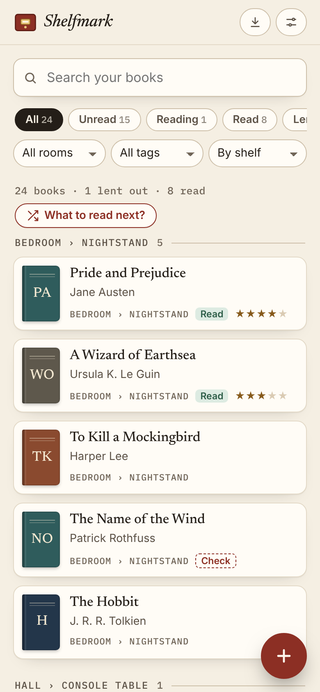
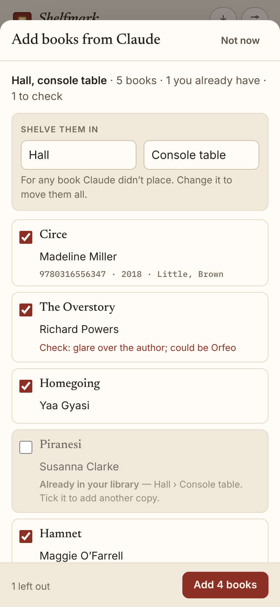
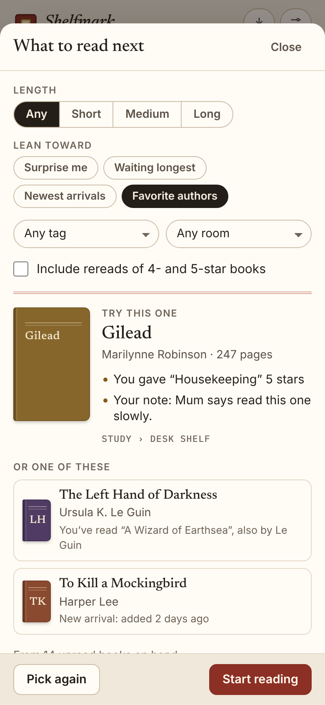

# Shelfmark

**Use it: [shelfmark.junkdrawer.works](https://shelfmark.junkdrawer.works/)**

**A catalog for the books in your house: what you have, where each one is, what you've read, and who borrowed what.** Photograph a shelf, send the photos to Claude, and open the link it gives you: Shelfmark shows the books to check, with the ones you already own unticked, before anything is added. Your catalog stays in your browser, and in your own Google Drive if you turn on sync.

<p align="center">
  
  &nbsp;
  
  &nbsp;
  
</p>

## How it works

- **Catalog.** For each book it keeps:
  - title, subtitle, authors
  - ISBN, publisher, year, pages, format
  - where it is: a room and a shelf, in your own words
  - unread, reading or read, and a rating
  - who you lent it to, and since when
  - tags and notes
  - edition details: signed, first edition, condition, printing
- **Find things.** Search matches every field, borrowers included. Filters cover status, lent out, room and tag. Sort by author, title, shelf (grouped under each room and shelf), or newest first.
- **Add from photos.** Claude reads spines, covers, barcodes and copyright pages and makes a Shelfmark link. Opening it shows the list first. There you can:
  - fix titles and authors;
  - put the whole batch on one shelf;
  - see books you already own, which are unticked;
  - see anything Claude wasn't sure of, marked **Check**.
  Checked books keep a **To check** filter until you say they're right.
- **What to read next.** Tap **What to read next?** for a suggestion from the unread books you have on hand (lent-out books are left out), with two more to choose from.
  - Narrow it by length (short is under 250 pages, long over 450), tag or room.
  - Lean it toward books **waiting longest**, the **newest arrivals**, or **favorite authors** (ones whose books you've read and rated highly). **Surprise me** is a plain random pick.
  - Tick **Include rereads** to bring back books you gave four or five stars.
  - Each suggestion says why, in plain words ("You gave “Housekeeping” 5 stars", "Your note: …"), and which shelf it's on. **Pick again** works through every match before repeating one, and **Start reading** marks it Reading.
  - Your choices are remembered on each device.
- **Covers and lookups** from Open Library, only if you turn them on in Settings. Covers are found by ISBN, or by title and author for a book without one (so a cover may show another edition), and each cover's id is remembered in the browser. Lookups send the ISBN, title and author, nothing else.
- **Backups.** Download the whole library as a file, open it on any device (it merges), or download a spreadsheet (CSV).
- No account and no server. Your catalog stays in your browser, and in your Google Drive if you turn on sync. It installs as an app (from the browser's menu, or Share → Add to Home Screen on an iPhone) and works offline; covers and looking up a book's details need a signal.

## Your data

The [privacy page](https://shelfmark.junkdrawer.works/privacy.html) (`privacy.html`) says this for anyone using it. Your catalog is kept in this browser's local storage and, if you turn on sync, in one file in your own Google Drive. Nothing else stores it: this site is static files, and links from Claude carry their books in the part of the address after `#`, which browsers never send to a server.

Shelfmark asks Google for the narrowest Drive permission there is (`drive.file`). It can see and change only files it made itself, which is one folder, `Shelfmark`, holding `Shelfmark library.json`. It can't see anything else in your Drive. After you sign in it asks Drive for your account's email address, which stays in your browser with the sign-in so that signing back in skips Google's account chooser.

## Sync across devices with Google Drive

Each device keeps its own copy and works offline. When you sync, Shelfmark:
1. reads the file in your Drive;
2. merges it with this device's copy, book by book, keeping whichever version was changed most recently;
3. writes it back if anything changed.

Removed books are remembered, so a removal on your phone reaches your laptop instead of the old copy coming back. Syncing happens:
- a few seconds after each change;
- when you come back to the tab;
- once a minute while the page is open;
- whenever you tap **Sync now**.

Google signs a page like this out after an hour. When that happens the sync button turns amber and says **Sync**, and one tap signs you back in. Your changes wait safely on the device until then.

The sign-in is kept for the hour under `junkdrawer.google` in localStorage, the same way as the other junkdrawer.works projects, with your account's email address (read from Drive's `about` endpoint after you sign in), so signing back in skips Google's account chooser. Shelfmark has its own address, so it signs in on its own. **Disconnect this device** only stops syncing here; it doesn't revoke Google's permission, which would sign every project out. To take the permission back, remove junkdrawer.works under Third-party apps & services in your Google Account.

Drive keeps earlier versions of the library file for 30 days (**File information › Manage versions** in Drive). If the file is ever damaged, Shelfmark leaves it alone rather than overwrite it, and says so.

### One-time setup

Sync needs an OAuth client ID from a Google Cloud project, tied to the address Shelfmark is served from. It takes about ten minutes:

1. In the [Google Cloud console](https://console.cloud.google.com/), create a project, for example "Shelfmark".
2. In **APIs & Services › Library**, find **Google Drive API** and enable it.
3. Open **Google Auth Platform** (called **OAuth consent screen** in older versions of the console) and choose **Get started**:
   - app name: Shelfmark
   - support email: your address
   - audience: **External**
   - contact email: your address
4. In **Data Access**, choose **Add or remove scopes**. Add `https://www.googleapis.com/auth/drive.file` ("See, edit, create, and delete only the specific Google Drive files you use with this app"), then save.
5. In **Branding**, fill in:
   - **Application home page:** `https://shelfmark.junkdrawer.works/`
   - **Application privacy policy link:** `https://shelfmark.junkdrawer.works/privacy.html`
   - **Authorized domains:** `junkdrawer.works`

   Save. Google won't publish the app without these, even though the form doesn't mark them required.
6. In **Audience**, choose **Publish app**. `drive.file` is a non-sensitive scope, so publishing needs no review. Or skip publishing: an app left in **Testing** works for the Google accounts you add under **Test users**, but Google may ask them to approve it again from time to time.
7. In **Clients**, create a client of type **Web application**. Under **Authorized JavaScript origins**, add the address Shelfmark is served from (for the junkdrawer.works copy, `https://shelfmark.junkdrawer.works`, plus `https://junkdrawer.works`, where it used to live), then create it and copy the **Client ID**. It ends in `.apps.googleusercontent.com`. A client ID isn't a secret; it only works from the origins you listed.
8. Put the ID in `GOOGLE_CLIENT_ID` near the top of the script in `index.html`. Until then, you can paste it into **Settings › Sync with Google Drive** on each device.

Then open **Settings › Connect Google Drive** on each device you use. The copy at shelfmark.junkdrawer.works already has its client ID.

## Adding books with Claude

`skill/shelfmark-cataloger/` is a skill for Claude. Send it photos of your shelves and it:
1. reads every spine, cover, barcode or copyright page, and says what it couldn't read;
2. checks each ISBN's check digit, so a misread ISBN is dropped and flagged rather than guessed;
3. hands the books to Shelfmark as a link and a `.shelfmark.json` file.

It can also convert a Goodreads or LibraryThing export, leaving out the books on your to-read shelf or wishlist that aren't in the house (it asks first). With a Google Drive connector, it can answer questions about your library by reading the library file, which it never changes.

To use it, zip the `shelfmark-cataloger` folder and upload it as a skill in claude.ai; it needs code execution turned on. Its script also runs on its own:

```
python3 skill/shelfmark-cataloger/scripts/make_shelfmark.py books.json
python3 skill/shelfmark-cataloger/scripts/make_shelfmark.py goodreads_library_export.csv --import goodreads
```

## Opening books from a link

A link like `https://shelfmark.junkdrawer.works/#s1z…` carries a batch of books in the part after `#`. Opening one shows the books and asks before adding them. Opening the same link again says so and unticks what's already there. The format is the batch JSON, compressed with raw DEFLATE and base64url-encoded; `#s1j…` is the same uncompressed. `#batch=` followed by URL-encoded JSON also works, for writing one by hand. `skill/shelfmark-cataloger/references/shelfmark-format.md` describes every field.

## File formats

- **A batch from Claude** is `{"shelfmark": 1, "batch": {…}}`.
- **A library backup, or the Drive file,** is `{"shelfmark": 1, "library": {"books": {…}, "seen": {…}}}`.

Both open from **Import › Open a file**. Opening a library merges it into yours. Anything that comes in is cleaned field by field first, so a hand-edited file can't break the page.

## Running it

It's a static site: plain HTML, CSS and JavaScript, with no build step. Open `index.html` in a browser, or host it anywhere static.

```sh
npx serve .                   # or any static file server, then open the printed address
npm test                      # checks the logic, then uses the page in Chromium (needs Playwright)
node tools/screenshots.mjs    # redraws docs/*.png and og.png
node tools/make-icons.mjs     # redraws the PNG icons from icon.svg
```

To put it online with GitHub Pages: **Settings → Pages → Build and deployment → Deploy from a branch**, then pick `main` and `/ (root)`. The `CNAME` file gives it its own address, shelfmark.junkdrawer.works.

### Tests

`npm test` runs two tests. `node test/e2e.mjs` uses the real page in Chromium (it needs Playwright), and nothing in it reaches the internet. It opens a link made by the skill's script, adds the books, edits one, and checks it all survives a reload and a reload offline, at phone size, with nothing scrolling sideways and nothing loaded from elsewhere. It also has two tabs, and two devices sharing a stand-in Google Drive, change the same book; and it checks the review screen's shelving and order, batches too big to take at once, links that are cut short, spreadsheets opened by mistake, erasing a device, signing back in to Google, the Back button, contrast, and the keyboard and screen readers in the sheets.

`node test/library.test.js` has no dependencies. It reads the logic straight out of `index.html` and checks:
- **ISBNs:** ISBN-10 to ISBN-13 conversion, and check digits.
- **Cleaning:** every field is trimmed, clamped and mapped.
- **Merging:** hundreds of random libraries merge the same whatever the order, and a later removal or edit wins.
- **Duplicates:** matched by ISBN, and by title and author surname.
- **Links:** compressed, uncompressed, hand-written and pasted links all open.
- **The skill's script:** its link and file open in the page with every field intact, a list of over 3,000 books comes out as numbered files, and Goodreads and LibraryThing exports come in cleaned up. This runs when `python3` is available.
- **Spreadsheet export:** quoting, and defusing cells that would otherwise run as formulas.
- **What to read next:** which books can be suggested, that each lean pulls the way it says, the reasons given, and that every match comes up before any repeats.

### Files

- `index.html`: the whole app, its styles and its script. The pure logic (cleaning books, merging, duplicates, links, the spreadsheet, what to read next) comes first in the script, where the unit test reads it.
- `privacy.html`: Shelfmark's privacy page.
- `fonts/`: Newsreader and IBM Plex Mono (SIL Open Font License), served from here so nothing loads from elsewhere.
- `sw.js`: keeps a copy for using offline.
- `manifest.webmanifest`, `icon.svg` and `icon-*.png`: what a phone needs to install it. `tools/make-icons.mjs` redraws the PNGs from `icon.svg` and `tools/icon-full-bleed.svg`.
- `og.png` and `docs/`: the link preview and the screenshots above, made by `tools/screenshots.mjs` from a sample library.
- `carry.js`: the first time Shelfmark opens at shelfmark.junkdrawer.works, brings your catalog over from its old address, junkdrawer.works/shelfmark/.
- `skill/shelfmark-cataloger/`: the skill for Claude, with its script and the format notes.
- `test/library.test.js` and `test/e2e.mjs`: the tests. `test/fake-google.mjs` stands in for Google sign-in and Drive.

## License

MIT — see [LICENSE](LICENSE).
